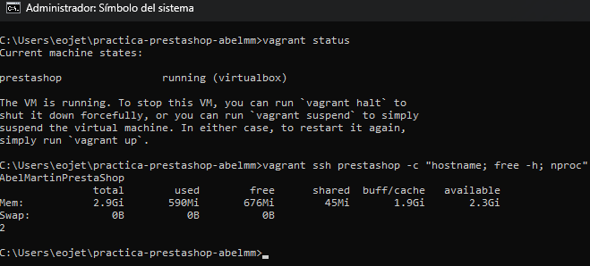
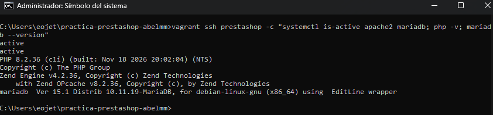
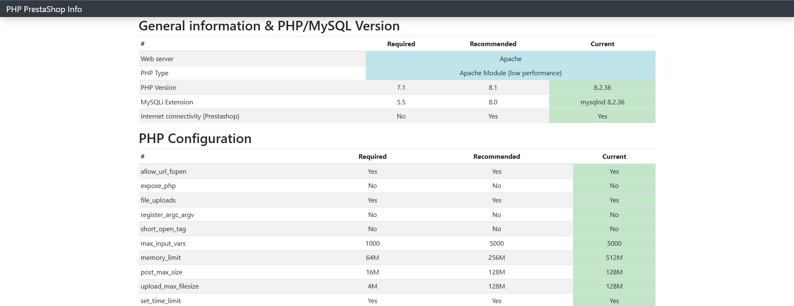
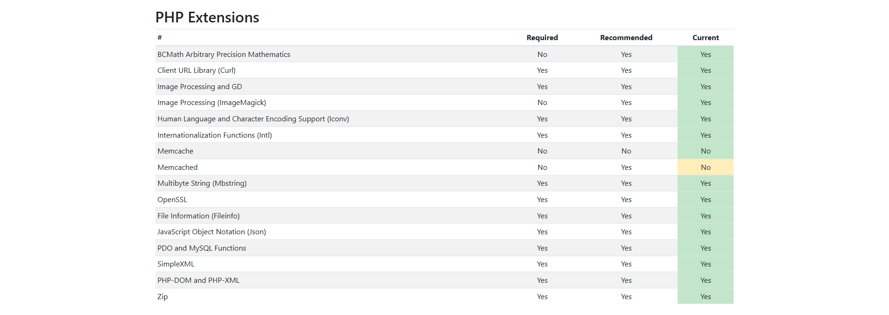
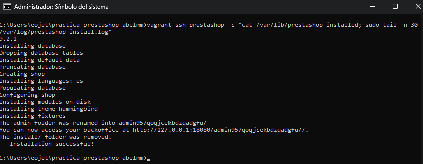
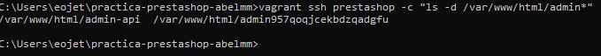
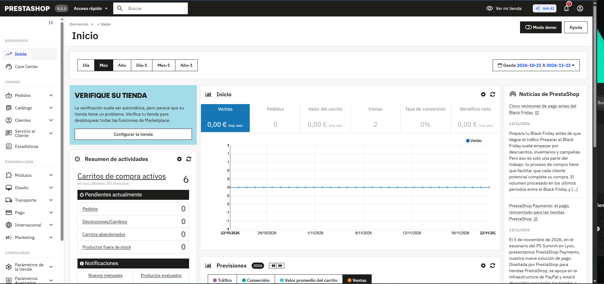
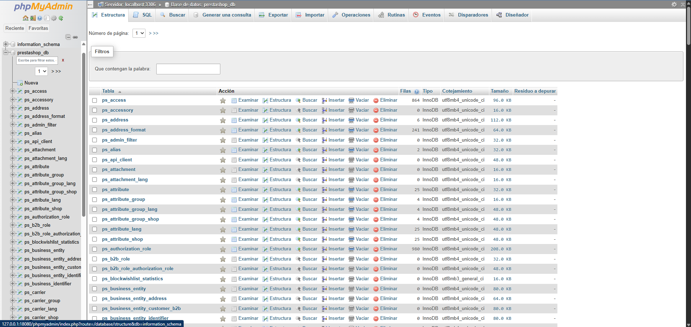
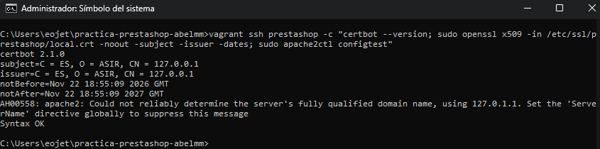

# Práctica 1.8 — Implantación de PrestaShop

Autor: Abel Martín  
Módulo: Implantación de Aplicaciones Web  
Entorno: Vagrant y VirtualBox

## 1. Introducción

Esta práctica consiste en automatizar la instalación y configuración de PrestaShop sobre una pila LAMP, comprobar los requisitos de la aplicación y verificar el acceso a la tienda, al panel de administración y a la base de datos.

El despliegue se realiza en una máquina virtual Debian 12 gestionada mediante Vagrant y VirtualBox. La instalación de los servicios y de la aplicación se automatiza mediante scripts de Bash.

El enunciado original plantea un despliegue en AWS. Este repositorio documenta su adaptación a un entorno local: no utiliza EC2, una AMI de Ubuntu, una IP elástica ni un dominio público. La configuración HTTPS utiliza un certificado autofirmado, no un certificado emitido por Let’s Encrypt.

## 2. Objetivos

- Preparar una máquina virtual con los recursos necesarios.
- Automatizar la instalación de Apache, MariaDB y PHP.
- Instalar las extensiones de PHP utilizadas por PrestaShop.
- Ajustar la configuración de PHP para el entorno web y la ejecución por terminal.
- Comprobar el entorno mediante PhpPsInfo.
- Instalar phpMyAdmin.
- Crear la base de datos y el usuario de la aplicación.
- Descargar e instalar PrestaShop mediante su instalador CLI.
- Configurar HTTPS para el laboratorio local.
- Documentar el procedimiento y las comprobaciones mediante capturas.

## 3. Arquitectura

Todos los servicios se ejecutan en una única máquina virtual.

```text
Equipo anfitrión: Windows
│
├── Vagrant y VirtualBox
│   └── Máquina virtual: prestashop
│       ├── Debian 12
│       ├── Apache
│       ├── PHP
│       ├── MariaDB
│       ├── phpMyAdmin
│       └── PrestaShop
│
├── http://127.0.0.1:18080  → Puerto 80 de la VM
└── [https://127.0.0.1:18443](https://127.0.0.1:18443) → Puerto 443 de la VM
```

### 3.1. Características de la máquina virtual

| Elemento | Configuración |
|---|---|
| Nombre lógico en Vagrant | `prestashop` |
| Nombre en VirtualBox | `AbelMartinPrestaShop-IAW18` |
| Hostname | `AbelMartinPrestaShop` |
| Box | `debian/bookworm64` |
| Sistema operativo | Debian 12 Bookworm |
| Memoria RAM asignada | 3072 MB |
| Procesadores virtuales | 2 |
| Directorio web | `/var/www/html` |
| Carpeta compartida del proyecto | `/vagrant` |

### 3.2. Servicios

| Servicio | Función |
|---|---|
| Apache 2.4 | Servidor HTTP y HTTPS |
| PHP 8.2 | Ejecución de PrestaShop |
| MariaDB 10.11 | Almacenamiento de los datos |
| phpMyAdmin | Administración web de la base de datos |
| PrestaShop Classic 9.2.1 | Aplicación de comercio electrónico |
| PhpPsInfo | Diagnóstico del entorno PHP |
| OpenSSL | Generación del certificado local |
| Certbot | Cliente ACME instalado para la gestión de certificados |

### 3.3. Puertos

| Servicio | Puerto del anfitrión | Puerto de la VM |
|---|---:|---:|
| HTTP | 18080 | 80 |
| HTTPS | 18443 | 443 |

Los puertos reenviados se vinculan a `127.0.0.1`, por lo que el acceso descrito se realiza desde el equipo anfitrión.

MariaDB no se publica mediante un puerto del anfitrión.

## 4. Estructura del repositorio

```text
.
├── README.md
├── Vagrantfile
├── .gitignore
├── .gitattributes
├── conf/
│   └── 000-default.conf
├── scripts/
│   ├── .env
│   ├── install_lamp.sh
│   ├── setup_letsencrypt_https.sh
│   └── deploy_prestashop.sh
└── capturas/
    ├── cap1-estado-vm.png
    ├── cap2-servicios-lamp.png
    ├── cap3-configuracion-php.png
    ├── cap4-extensiones-php.png
    ├── cap5-instalacion-cli.png
    ├── cap6-tienda.png
    ├── cap7-administracion.png
    ├── cap8-base-datos.png
    └── cap9-certificado-local.png
```

### 4.1. Función de los archivos

| Archivo | Función |
|---|---|
| `Vagrantfile` | Define la máquina, los recursos, los puertos y el orden del aprovisionamiento |
| `conf/000-default.conf` | Configuración del VirtualHost HTTP de Apache |
| `scripts/.env` | Variables de configuración del laboratorio |
| `scripts/install_lamp.sh` | Instalación y configuración de LAMP, phpMyAdmin y PhpPsInfo |
| `scripts/setup_letsencrypt_https.sh` | Configuración TLS según el modo seleccionado |
| `scripts/deploy_prestashop.sh` | Creación de la base de datos e instalación de PrestaShop por CLI |
| `.gitignore` | Exclusión de archivos que no deben publicarse |
| `.gitattributes` | Configuración de finales de línea para los scripts |
| `capturas/` | Evidencias del despliegue |

## 5. Preparación del entorno

### 5.1. Requisitos del equipo anfitrión

Para reproducir el despliegue se necesita:

- VirtualBox.
- Vagrant.
- Git.
- Virtualización habilitada.
- Memoria suficiente para asignar 3 GB a la máquina virtual.
- Conexión a Internet para descargar la box, los paquetes y la aplicación.
- Puertos locales `18080` y `18443` disponibles.

### 5.2. Descarga del repositorio

Desde CMD de Windows:

```cmd
git clone [https://github.com/AbelmmAsir2/practica-prestashop-abelmm.git](https://github.com/AbelmmAsir2/practica-prestashop-abelmm.git)
cd practica-prestashop-abelmm
```

### 5.3. Variables de configuración

El archivo `scripts/.env` centraliza los parámetros utilizados por los scripts:

- Dirección del entorno local.
- Puertos HTTP y HTTPS.
- Modo de configuración TLS.
- Correo de contacto para Certbot.
- Nombre de la base de datos.
- Usuario y contraseña de la base de datos.
- Nombre de la tienda.
- Nombre, apellidos, correo y contraseña del administrador.

Los scripts localizan este archivo a partir de su propia ubicación:

```bash
ROOT="$(cd "$(dirname "${BASH_SOURCE}")/.." && pwd)"
source "$ROOT/scripts/.env"
```

Las credenciales incluidas corresponden exclusivamente a este laboratorio y no deben reutilizarse en servicios reales.

## 6. Creación y arranque de la máquina

### 6.1. Validación del Vagrantfile

```cmd
vagrant validate
```

### 6.2. Arranque y aprovisionamiento

```cmd
vagrant up --provision
```

El aprovisionamiento ejecuta los scripts en este orden:

1. `install_lamp.sh`.
2. `setup_letsencrypt_https.sh`.
3. `deploy_prestashop.sh`.

Los scripts se ejecutan dentro de la máquina virtual desde la carpeta compartida `/vagrant`.

### 6.3. Comprobación del estado y los recursos

```cmd
vagrant status
vagrant ssh prestashop -c "hostname; free -h; nproc"
```

Se comprueba el estado de la máquina, su hostname, la memoria disponible y el número de procesadores virtuales.



## 7. Instalación de la pila LAMP

El script `install_lamp.sh` actualiza los índices de paquetes e instala los componentes del entorno:

- Apache.
- MariaDB.
- PHP y el módulo de integración con Apache.
- Extensiones PHP.
- phpMyAdmin.
- Utilidades de descarga y extracción.
- OpenSSL y Certbot.

### 7.1. Extensiones PHP

Entre las extensiones instaladas se encuentran:

```text
php-mysql
php-curl
php-gd
php-intl
php-mbstring
php-xml
php-zip
php-bcmath
php-soap
php-imagick
```

### 7.2. Módulos de Apache

Se habilitan los módulos:

```bash
a2enmod rewrite ssl headers
```

El módulo `rewrite` permite aplicar las reglas de reescritura utilizadas por la aplicación.

### 7.3. VirtualHost HTTP

El archivo `conf/000-default.conf` configura `/var/www/html` como raíz del sitio:

```apache
<VirtualHost *:80>
    ServerName 127.0.0.1
    DocumentRoot /var/www/html

    <Directory /var/www/html>
        AllowOverride All
        Require all granted
        DirectoryIndex index.php index.html
    </Directory>

    ErrorLog ${APACHE_LOG_DIR}/error.log
    CustomLog ${APACHE_LOG_DIR}/access.log combined
</VirtualHost>
```

La directiva `AllowOverride All` permite aplicar la configuración de los archivos `.htaccess`.

### 7.4. Comprobación de servicios

```cmd
vagrant ssh prestashop -c "systemctl is-active apache2 mariadb; php -v; mariadb --version"
```



## 8. Configuración de PHP

El script crea un archivo `99-prestashop.ini` para los dos entornos de ejecución:

```text
/etc/php/8.2/apache2/conf.d/99-prestashop.ini
/etc/php/8.2/cli/conf.d/99-prestashop.ini
```

Esto permite aplicar la configuración tanto a las peticiones del navegador como al instalador por línea de comandos.

| Directiva | Valor |
|---|---|
| `memory_limit` | `512M` |
| `max_input_vars` | `5000` |
| `post_max_size` | `128M` |
| `upload_max_filesize` | `128M` |
| `max_execution_time` | `300` |
| `date.timezone` | `Europe/Madrid` |
| `allow_url_fopen` | `On` |
| `expose_php` | `Off` |

Después de aplicar los cambios se reinicia Apache.

## 9. Comprobación mediante PhpPsInfo

El script de instalación descarga `phppsinfo.php` desde el repositorio oficial de la herramienta y lo coloca en:

```text
/var/www/html/phppsinfo.php
```

Acceso desde el navegador:

```text
http://127.0.0.1:18080/phppsinfo.php
```

Credenciales predeterminadas:

```text
Usuario: prestashop
Contraseña: prestashop
```

La herramienta permite revisar:

- Información del servidor.
- Versión de PHP.
- Configuración efectiva de PHP.
- Extensiones disponibles.
- Permisos de los directorios que comprueba.

Este diagnóstico se utiliza junto con la comprobación de dependencias del paquete de PrestaShop; no sustituye la revisión de compatibilidad de la versión instalada.

### 9.1. Configuración PHP



### 9.2. Extensiones PHP



## 10. Preparación de la base de datos

El script `deploy_prestashop.sh` crea la base de datos de la aplicación con codificación `utf8mb4`:

```sql
CREATE DATABASE IF NOT EXISTS prestashop_db
CHARACTER SET utf8mb4
COLLATE utf8mb4_unicode_ci;
```

También crea el usuario local configurado en `.env`, actualiza su contraseña y le concede permisos sobre la base de datos de PrestaShop.

El usuario de la aplicación se limita a conexiones desde `localhost`.

Las tablas creadas por el instalador utilizan el prefijo:

```text
ps_
```

## 11. Descarga e instalación de PrestaShop

### 11.1. Versión utilizada

Se utiliza PrestaShop Classic 9.2.1.

Durante el despliegue, la consulta de la última publicación de GitHub devolvió esta versión, pero no incluía un paquete instalable entre sus archivos adjuntos.

Por este motivo, el script utiliza el paquete preparado de la distribución oficial:

```text
[https://api.prestashop-project.org/assets/prestashop-classic/9.2.1-6.1/prestashop.zip](https://api.prestashop-project.org/assets/prestashop-classic/9.2.1-6.1/prestashop.zip)
```

La versión queda fijada en el script para reproducir el despliegue. El procedimiento actual no selecciona automáticamente futuras versiones.

### 11.2. Descarga y extracción

El script realiza las siguientes operaciones:

1. Crea un directorio temporal.
2. Descarga el ZIP mediante `curl`.
3. Comprueba el archivo con `unzip -tq`.
4. Extrae su contenido.
5. Si existe un ZIP interno `prestashop.zip`, lo descomprime sobre `/var/www/html`.
6. Si el paquete ya contiene el instalador, copia su contenido al directorio web.
7. Comprueba la existencia del autoloader y del instalador.
8. Asigna los archivos al usuario `www-data`.

Archivos comprobados:

```text
/var/www/html/vendor/autoload.php
/var/www/html/install/index_cli.php
```

Además, se carga el autoloader de Composer para detectar errores de dependencias antes de continuar.

### 11.3. Instalación mediante CLI

El instalador se ejecuta como usuario `www-data`:

```bash
runuser -u www-data -- php index_cli.php \
    --domain="${DOMAIN}:${HTTP_PORT}" \
    --db_server=localhost \
    --db_name="$DB_NAME" \
    --db_user="$DB_USER" \
    --db_password="$DB_PASSWORD" \
    --prefix=ps_ \
    --name="$SHOP_NAME" \
    --firstname="$ADMIN_FIRSTNAME" \
    --lastname="$ADMIN_LASTNAME" \
    --email="$ADMIN_EMAIL" \
    --password="$ADMIN_PASSWORD" \
    --language=es \
    --country=es \
    --ssl=0 \
    --rewrite=1
```

La instalación configura:

- El dominio local con su puerto HTTP.
- La conexión a MariaDB.
- El prefijo de tablas `ps_`.
- El nombre de la tienda.
- La cuenta del administrador.
- El idioma español.
- El país España.
- La reescritura de URLs.

La opción `--ssl=0` mantiene HTTP como dirección canónica de la tienda.

### 11.4. Registro de instalación

La salida del instalador se guarda en:

```text
/var/log/prestashop-install.log
```

Cuando finaliza correctamente se registra la versión en:

```text
/var/lib/prestashop-installed
```

Comprobación:

```cmd
vagrant ssh prestashop -c "cat /var/lib/prestashop-installed; sudo tail -n 30 /var/log/prestashop-install.log"
```



### 11.5. Operaciones posteriores

Tras completar la instalación, el script:

- Configura el dominio y puerto HTTPS en `ps_shop_url.domain_ssl`.
- Elimina el directorio `install`.
- Renombra `admin` a `admin_abel_lab` si todavía existe una carpeta con ese nombre exacto.
- Conserva el nombre generado si el instalador ya ha renombrado la carpeta administrativa.
- Revisa la propiedad de los archivos.
- Guarda el marcador de instalación terminada.

El marcador evita repetir una instalación ya completada. No es un mecanismo de actualización ni garantiza la recuperación automática de una instalación interrumpida.

## 12. Comprobación de la tienda

La tienda se abre desde el equipo anfitrión:

```text
http://127.0.0.1:18080/
```

Se conserva el contenido de demostración incluido con PrestaShop para comprobar la carga de la aplicación y su catálogo.

El entorno corresponde a una práctica local y no a una tienda comercial en producción.



## 13. Acceso al panel de administración

La carpeta administrativa se consulta mediante:

```cmd
vagrant ssh prestashop -c "ls -d /var/www/html/admin*"
```

Entre los resultados puede aparecer `admin-api`, que no es la ruta de acceso al Back Office.

Se utiliza la carpeta de administración generada durante la instalación. Su nombre puede variar al reproducir el despliegue.

La dirección tiene este formato:

```text
http://127.0.0.1:18080/NOMBRE_DE_LA_CARPETA_ADMIN/
```

El inicio de sesión se realiza con las variables:

```text
ADMIN_EMAIL
ADMIN_PASSWORD
```

Estas variables se encuentran en `scripts/.env`.



## 14. Acceso a phpMyAdmin

phpMyAdmin está disponible en:

```text
http://127.0.0.1:18080/phpmyadmin/
```

El acceso se realiza con el usuario de base de datos definido en `.env`.

Al seleccionar `prestashop_db` se puede consultar la estructura de tablas creada por el instalador.



## 15. Configuración HTTPS

El script `setup_letsencrypt_https.sh` contempla dos modos de funcionamiento.

### 15.1. Modo local

Configuración utilizada:

```bash
TLS_MODE="local"
```

En este modo se genera un certificado autofirmado mediante OpenSSL.

Archivos generados:

```text
/etc/ssl/prestashop/local.crt
/etc/ssl/prestashop/local.key
```

El certificado incluye `127.0.0.1` y `localhost` como nombres alternativos. La clave privada se guarda con permisos restringidos.

El VirtualHost HTTPS se configura en:

```text
/etc/apache2/sites-available/prestashop-ssl.conf
```

El puerto 443 de Apache se publica en el puerto 18443 del anfitrión.

### 15.2. Modo Let’s Encrypt

El script dispone de una rama para ejecutar Certbot cuando se selecciona:

```bash
TLS_MODE="letsencrypt"
```

Este modo requiere un dominio público correctamente configurado y que la validación ACME pueda alcanzar el servidor.

No se ha utilizado este modo en el laboratorio local ni se ha emitido un certificado público de Let’s Encrypt.

### 15.3. Comprobación del certificado

```cmd
vagrant ssh prestashop -c "certbot --version; sudo openssl x509 -in /etc/ssl/prestashop/local.crt -noout -subject -issuer -dates; sudo apache2ctl configtest"
```

La comprobación permite consultar:

- Versión de Certbot.
- Sujeto del certificado.
- Emisor.
- Fechas de validez.
- Sintaxis de la configuración de Apache.



### 15.4. Limitaciones de HTTPS en el laboratorio

El acceso TLS de Apache se publica en:

```text
[https://127.0.0.1:18443/](https://127.0.0.1:18443/)
```

El navegador puede mostrar una advertencia porque el certificado es autofirmado y no está emitido por una autoridad de confianza.

Además, configurar TLS en Apache no activa por sí solo HTTPS obligatorio en PrestaShop. La tienda se ha instalado con HTTP como dirección canónica, por lo que puede redirigir a esa dirección.

Tener Certbot instalado no acredita la emisión de un certificado de Let’s Encrypt.

## 16. Incidencias y soluciones

### 16.1. Ruta del script no encontrada

Vagrant no encontraba el archivo de aprovisionamiento en la ubicación configurada.

Se reorganizó el proyecto con la estructura definitiva:

```text
scripts/
├── .env
├── install_lamp.sh
├── setup_letsencrypt_https.sh
└── deploy_prestashop.sh
```

El `Vagrantfile` ejecuta los scripts desde `/vagrant/scripts`.

### 16.2. Puerto 8080 ocupado

El puerto 8080 del equipo anfitrión ya estaba en uso.

Se cambiaron los puertos publicados:

```text
HTTP:  18080 → 80
HTTPS: 18443 → 443
```

También se ajustaron las direcciones utilizadas durante la instalación de PrestaShop.

### 16.3. Nombre duplicado en VirtualBox

Ya existía una máquina registrada con el nombre `AbelMartinPrestaShop`.

Se cambió el nombre de VirtualBox a:

```text
AbelMartinPrestaShop-IAW18
```

Se conservó el hostname:

```text
AbelMartinPrestaShop
```

### 16.4. Máquina arrancada sin instalación terminada

El estado `running` de Vagrant no garantizaba que el aprovisionamiento hubiera finalizado.

Se comprobó la existencia del marcador y del registro de instalación. Al no encontrarse, se obtuvo el diagnóstico con:

```cmd
vagrant provision prestashop > diagnostico-provision.txt 2>&1
```

### 16.5. Paquete instalable no encontrado en GitHub

La última publicación consultada no incluía el archivo esperado entre sus adjuntos.

Se sustituyó la selección de archivos de GitHub por la descarga del paquete oficial Classic 9.2.1.

### 16.6. Aviso de Apache sobre el nombre del servidor

Durante las comprobaciones apareció el aviso:

```text
AH00558: Could not reliably determine the server's fully qualified domain name
```

Apache devolvía también:

```text
Syntax OK
```

Este aviso no era la causa del fallo de instalación. El proceso se detenía posteriormente al buscar el paquete de PrestaShop.

## 17. Comandos de operación

Los siguientes comandos se ejecutan desde la raíz del proyecto.

### Consultar el estado

```cmd
vagrant status
```

### Acceder por SSH

```cmd
vagrant ssh prestashop
```

### Apagar la máquina

```cmd
vagrant halt
```

### Arrancar una máquina ya creada

```cmd
vagrant up
```

### Repetir el aprovisionamiento

```cmd
vagrant provision prestashop
```

### Ejecutar únicamente el despliegue

```cmd
vagrant ssh prestashop -c "sudo bash /vagrant/scripts/deploy_prestashop.sh"
```

Si existe el marcador de instalación terminada, el script no reinstala la aplicación.

Antes de modificar una instalación con datos se debe realizar una copia de seguridad.

## 18. Seguridad y limitaciones

- Las credenciales del repositorio son de laboratorio y no deben reutilizarse.
- La carpeta `.vagrant` y las claves privadas no deben publicarse.
- PhpPsInfo muestra información técnica del servidor y debe retirarse o restringirse antes de exponer el entorno.
- phpMyAdmin debe protegerse y restringirse si se publica el servidor fuera del equipo anfitrión.
- El directorio `install` se elimina tras completar la instalación.
- No se han configurado pagos, envíos de correo reales, copias de seguridad programadas ni servicios propios de una tienda comercial.
- El certificado utilizado es autofirmado.
- La configuración local no implementa los recursos de AWS solicitados en el enunciado original.
- La aceptación de esta adaptación local depende de los criterios de evaluación del profesor.

## 19. Resumen de evidencias

| Captura | Contenido |
|---|---|
| `cap1-estado-vm.png` | Estado de la VM, hostname, memoria y procesadores |
| `cap2-servicios-lamp.png` | Servicios LAMP y versiones |
| `cap3-configuracion-php.png` | Configuración PHP mediante PhpPsInfo |
| `cap4-extensiones-php.png` | Extensiones PHP mediante PhpPsInfo |
| `cap5-instalacion-cli.png` | Registro de instalación mediante CLI |
| `cap6-tienda.png` | Portada de PrestaShop |
| `cap7-administracion.png` | Panel de administración |
| `cap8-base-datos.png` | Tablas de PrestaShop en phpMyAdmin |
| `cap9-certificado-local.png` | Certificado autofirmado y sintaxis de Apache |

## 20. Conclusiones

El proyecto reúne la configuración necesaria para desplegar PrestaShop en una máquina virtual local mediante Vagrant y scripts de Bash.

La separación de la instalación de LAMP, la configuración TLS y el despliegue de la aplicación facilita la revisión de cada fase y la identificación de errores.

Las principales incidencias estuvieron relacionadas con las rutas de los scripts, los puertos ocupados, el nombre de la máquina virtual y la ubicación del paquete instalable. Las correcciones se incorporaron a la configuración del proyecto.

Las capturas documentan el recorrido de comprobación de la infraestructura, los requisitos PHP, la instalación CLI, la tienda, la administración, la base de datos y el certificado local.

## 21. Repositorio y entrega

Repositorio del proyecto:

https://github.com/AbelmmAsir2/practica-prestashop-abelmm

El repositorio contiene:

- Documento técnico en Markdown.
- Vagrantfile.
- Configuración de Apache.
- Variables del laboratorio.
- Scripts de Bash.
- Capturas de las comprobaciones.

Para completar la entrega se debe verificar que todos los archivos están publicados y añadir al profesor como colaborador desde la configuración del repositorio.

## 22. Documentación de consulta

- [Documentación de PrestaShop](https://devdocs.prestashop-project.org/9/)
- [Requisitos de PrestaShop](https://devdocs.prestashop-project.org/9/basics/installation/system-requirements/)
- [Instalación de PrestaShop mediante CLI](https://devdocs.prestashop-project.org/9/basics/installation/advanced/install-from-cli/)
- [PhpPsInfo](https://github.com/PrestaShop/php-ps-info)
- [Vagrant](https://developer.hashicorp.com/vagrant/docs)
- [VirtualBox](https://www.virtualbox.org/)
- [Certbot](https://certbot.eff.org/)
